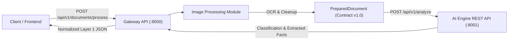

# IVP+AI: AI-Based Document Understanding and Information Extraction System

A modular, production-ready system for processing document images, extracting unstructured textual content via OCR, classifying document types, and extracting structured information with explainable rule-based forward chaining.

---

## Architecture Overview



- **Layer 1 (Primary Deliverable):** Core document processing pipeline comprising image preprocessing, Tesseract OCR, conservative text cleaning, keyword-based classification, invoice field extraction, and forward-chaining reasoning.
- **REST Integration:** Decoupled architecture where the Document Gateway API (`api.main:app`) communicates with the AI Engine (`modules/ai-engine/api.py`) over HTTP using the `PreparedDocument` JSON schema contract.
- **Demonstration UI:** Lightweight web frontend served directly by the gateway.

---

## Prerequisites

- **Python:** 3.11 or higher.
- **Tesseract OCR:** Installed on the system:
  - **Windows:** [UB-Mannheim Tesseract installer](https://github.com/UB-Mannheim/tesseract/wiki) (default installation location: `C:\Program Files\Tesseract-OCR\tesseract.exe`).
  - **Linux:** `sudo apt-get install -y tesseract-ocr`
  - **macOS:** `brew install tesseract`

---

## Installation & Setup

1. **Clone the repository:**
   ```bash
   git clone https://github.com/Algor8m/AI-Based-Document-Understanding-and-Information-Extraction.git
   cd "AI-Based-Document-Understanding-and-Information-Extraction"
   ```

2. **Create and activate a virtual environment:**
   ```powershell
   # Windows PowerShell
   python -m venv .venv
   .\.venv\Scripts\Activate.ps1
   ```
   ```bash
   # Linux / macOS
   python3 -m venv .venv
   source .venv/bin/activate
   ```

3. **Install dependencies:**
   ```bash
   pip install --upgrade pip
   pip install -r requirements.txt
   ```

4. **Verify Tesseract installation:**
   ```powershell
   where.exe tesseract
   # Or set the environment variable if installed in a custom location:
   # $env:TESSERACT_CMD = "C:\CustomPath\tesseract.exe"
   ```

---

## Starting the Services

The system runs as two independent REST services that communicate over HTTP.

### Option A: One-Click Windows Startup (Recommended)
Double-click or run from PowerShell / Command Prompt:
```powershell
# Windows Command Prompt / Batch
start_system.bat

# Windows PowerShell
.\start_system.ps1
```
This automatically launches both backend services in the background and opens `http://127.0.0.1:8000/` in your browser.

### Option B: Manual Service Startup in Separate Terminals

#### 1. Start the AI Engine Service (Port 8001)
In a dedicated terminal:
```bash
# From project root
python -m uvicorn api:app --app-dir modules/ai-engine --host 127.0.0.1 --port 8001
```
*Health check:* `http://127.0.0.1:8001/`

#### 2. Start the Document Processing Gateway (Port 8000)
In a second terminal:
```bash
# From project root
python -m uvicorn api.main:app --host 127.0.0.1 --port 8000
```
*Web interface:* `http://127.0.0.1:8000/`
*Interactive OpenAPI docs:* `http://127.0.0.1:8000/docs`

---

## API Endpoints

### Gateway Service (`http://127.0.0.1:8000`)

| Method | Endpoint | Description |
|---|---|---|
| `POST` | `/api/v1/documents/process` | Full end-to-end processing (image → OCR → AI reasoning → structured JSON) |
| `POST` | `/api/v1/documents/prepare` | Image preparation & OCR only (`PreparedDocument` output) |
| `GET` | `/api/v1/runs/{run_id}/stages/{stage_name}` | Serve verified intermediate stage image (PNG) |
| `GET` | `/api/v1/health` | Service health status |
| `GET` | `/api/v1/info` | Service metadata, accepted formats, and active endpoints |
| `GET` | `/` | Web frontend |

### AI Engine Service (`http://127.0.0.1:8001`)

| Method | Endpoint | Description |
|---|---|---|
| `POST` | `/api/v1/analyze` | Receives document text, returns classifications, extracted facts, and reasoning |
| `GET` | `/` | AI Engine health check |

---

## Example Usage

### End-to-End Processing Request (`curl`)
```bash
curl -X POST "http://127.0.0.1:8000/api/v1/documents/process" \
  -F "file=@sample_invoice.png" \
  -F "document_id=inv-2026-001"
```

### Successful Response Format
```json
{
  "request_id": "req-9c878fb6-7cc0-496e-a342-998f45a0b7d4",
  "document_id": "inv-2026-001",
  "status": "success",
  "data": {
    "document_type": "invoice",
    "classification": {
      "document_type": "invoice",
      "classification_method": "keyword_rules",
      "confidence": "medium"
    },
    "extracted_facts": {
      "emails": ["billing@example.com"],
      "phone_numbers": [],
      "dates": ["2026-10-20"],
      "text_length": 116,
      "invoice_number": "INV-2026-001",
      "invoice_date": "2026-10-20",
      "amount_due": "12500.00"
    },
    "inferred_facts": {
      "document_type": "invoice",
      "has_email": true,
      "contact_information_present": true,
      "has_contact_method": true
    },
    "reasoning": [
      {
        "rule": "EmailContactRule",
        "conclusion": {"contact_information_present": true},
        "explanation": "The document contains an email address."
      },
      {
        "rule": "ContactMethodRule",
        "conclusion": {"has_contact_method": true},
        "explanation": "The document has a contact method."
      }
    ]
  },
  "prepared_document": {
    "schema_version": "1.0",
    "document_id": "inv-2026-001",
    "source": {"type": "image", "filename": "sample_invoice.png"},
    "text": "INVOICE\nInvoice Number: INV-2026-001\n...",
    "metadata": {
      "page_count": 1,
      "image_width": 900,
      "image_height": 400,
      "image_format": "PNG",
      "ocr_engine": "tesseract",
      "preprocessing_operations": ["exif_orientation", "grayscale", "autocontrast", "contrast_adjustment"],
      "processing_duration_ms": 112.5
    },
    "warnings": []
  },
  "processing": {
    "image_processing": "success",
    "ai_extraction": "success"
  },
  "warnings": [],
  "errors": []
}
```

---

## Running the Test Suite

Execute all tests from the repository root:

```bash
# Run full test suite (51 tests)
pytest

# Run with verbose output
pytest -v

# Run specific test modules
pytest tests/test_integration_process.py
pytest tests/test_e2e_live.py
pytest tests/test_image_processing.py
pytest modules/ai-engine/tests/
```

---

## Known Limitations

1. **OCR Single-Page Scope:** Currently processes single-page PNG and JPEG documents. Multi-page PDF or TIFF ingestion is not yet supported.
2. **Orientation Detection:** Orientation relies on EXIF metadata; arbitrary visual skew or unoriented scans require manual upright orientation.
3. **Template Coverage:** Invoice field extraction relies on label-anchored patterns (`Invoice Number:`, `Amount Due:`, etc.). Highly non-standard layouts without standard labels may fail to extract specific fields and return `null`.
4. **Demonstration Layers:** Layers 2 and 3 are temporary demonstration modules and are not required for Layer 1 core operations.
