# IVP+AI: OCR and AI Reliability Engineering Report

## Executive Summary

This report documents the architectural inspection, baseline defects, reliability enhancements, and verification outcomes for the **IVP+AI: AI-Based Document Understanding and Information Extraction System**.

The primary objective was to improve the reliability, accuracy, error handling, and test coverage of the existing Layer 1 prototype without rebuilding the working architecture or introducing external commercial dependencies. All enhancements were implemented directly in the existing Python/FastAPI/Pillow/Tesseract pipeline and verified against automated unit, integration, and end-to-end acceptance test suites.

---

## 1. Architecture Findings & Pipeline Overview

The IVP+AI system is structured into two decoupled REST services communicating over HTTP:

```mermaid
flowchart LR
    Client["Demonstration UI / API Client"] -->|POST /api/v1/documents/process| Gateway["Gateway API (:8000)"]
    Gateway --> Val["Image Validation (Signatures & Dims)"]
    Val --> Prep["Image Preprocessor (EXIF, OSD, Deskew, Scale)"]
    Prep --> OCR["Tesseract OCR Engine (PSM 3 + Fallback)"]
    OCR --> Clean["Conservative Text Cleaner"]
    Clean --> Contract["PreparedDocument (Contract v1.0)"]
    Contract -->|POST /api/v1/analyze| AIEngine["AI Engine REST API (:8001)"]
    AIEngine --> Extract["Fact Extractor + Field Evidence"]
    Extract --> Classify["Document Classifier"]
    Classify --> FC["Forward-Chaining Reasoning Engine"]
    FC --> Gateway
    Gateway -->|Normalized Layer 1 JSON| Client
```

### Component Responsibilities

1. **Gateway API Service (`api/main.py` - Port 8000):**
   - Ingests uploaded image binaries and metadata (`POST /api/v1/documents/process`, `POST /api/v1/documents/prepare`).
   - Serves verified intermediate pipeline stages (`GET /api/v1/runs/{run_id}/stages/{stage_name}`).
   - Orchestrates preprocessing, OCR, and REST communication with the AI Engine.
   - Enforces public error contracts and hosts the demonstration UI (`GET /`, `/static/*`).

2. **Image Processing Module (`image_processing/`):**
   - `validator.py`: Enforces file type, magic byte signatures, file size, and dimension limits.
   - `preprocessor.py`: Applies conservative image enhancement (EXIF transpose, visual rotation correction, deskewing, grayscale mapping, Lanczos upscaling, and contrast normalization).
   - `ocr_engine.py`: Interfaces with UB-Mannheim Tesseract OCR, captures empirical word-level confidence, and provides multi-PSM fallback.
   - `text_cleaner.py`: Conservative text normalization preserving line breaks, reading order, and punctuation.
   - `run_storage.py`: Persists intermediate stage images per run UUID with path-traversal protection and automatic pruning.
   - `document_processor.py`: Orchestrates image validation, preprocessing, OCR, fallback logic, and metadata packaging.

3. **AI Engine Service (`modules/ai-engine/` - Port 8001):**
   - `document_classifier.py`: Explainable keyword-based document categorization (`invoice`, `service_agreement`, `general_document`).
   - `extractor.py`: Deterministic entity extraction for invoice numbers, invoice dates, amounts due, emails, phone numbers, agreement parties, and effective dates, along with source evidence tracking.
   - `knowledge_base.py`: In-memory isolated storage separating source facts from derived facts.
   - `rule_engine.py` & `forward_chaining.py`: Forward-chaining inference engine deriving semantic conclusions through fixed-point iteration.
   - `result_formatter.py`: Normalizes extracted and inferred facts into contract-compliant payloads.

---

## 2. Baseline Defects and Fragilities Identified

Before modification, the baseline codebase was inspected and tested (62 tests passing). The following defects, fragilities, and coverage gaps were identified:

| Defect / Gap ID | Component | Description & Operational Impact |
|---|---|---|
| **DEF-01** | `image_processing/validator.py` | **Missing File Signature (Magic Bytes) Verification:** The validator relied solely on file extensions. A renamed file (e.g. BMP/executable named `.png`) passed extension checks and was sent to Pillow decompression. |
| **DEF-02** | `image_processing/validator.py` | **Missing Dimension Boundaries & Decompression Bomb Protection:** No minimum or maximum pixel dimension checks existed. Inputs with 0x0 dimensions or extreme dimensions (e.g., 50,000x50,000 px) could freeze memory or crash the process. |
| **DEF-03** | `image_processing/preprocessor.py` | **Lack of Visual Orientation & Skew Correction:** Preprocessing relied exclusively on EXIF metadata. Standard scanned documents without EXIF metadata that were rotated (90°/180°/270°) or tilted produced garbled or missing OCR text. |
| **DEF-04** | `image_processing/preprocessor.py` | **Transparent PNG Artifacts:** Transparent PNGs (RGBA) had no background compositing, resulting in black background fills during grayscale conversion that obliterated black text. |
| **DEF-05** | `image_processing/ocr_engine.py` | **Missing OCR Confidence & Single-PSM Rigidity:** OCR ran in PSM 3 mode only and captured no confidence metrics. Degraded or low-contrast text that failed in PSM 3 failed completely without trying uniform block (PSM 6) fallback. |
| **DEF-06** | `image_processing/document_processor.py` | **Missing Preprocessing Fallback:** If aggressive contrast or upscaling caused OCR to yield empty text, there was no fallback to test the original image. |
| **DEF-07** | `api/main.py` | **Lack of Bounded Retries on Transient Failures:** Single transient connection glitches or timeouts immediately resulted in 502/504 errors without bounded retry recovery. |
| **DEF-08** | `api/main.py` | **Fragile AI Output Schema Assumption:** Gateway assumed AI Engine would always return fully populated dictionaries. Missing keys in AI responses could crash Gateway serialization. |
| **DEF-09** | `modules/ai-engine/src/extractor.py` | **Missing Source Evidence Tracking:** Extracted facts (e.g., `invoice_number`, `amount_due`) lacked supporting OCR text snippets, preventing auditability. |
| **DEF-10** | `modules/ai-engine/src/extractor.py` | **Limited Service Agreement Entity Extraction:** Agreements were classified correctly, but contract parties and effective dates were not extracted into structured facts. |

---

## 3. Implemented Improvements & Fixes

### 3.1 Robust Image Validation (`image_processing/validator.py`)
- **Magic Byte Verification:** Validates file signatures (`b"\x89PNG\r\n\x1a\n"` for PNG; `b"\xff\xd8\xff"` for JPEG).
- **Dimension Clamping:** Enforces minimum dimensions ($10 \times 10$ pixels) and maximum dimensions ($10,000 \times 10,000$ pixels, capped at 25 MP total).
- **Graceful Error Handling:** Catches `Image.DecompressionBombError`, `UnidentifiedImageError`, and corrupted pixel payloads, returning structured 400 (`INVALID_IMAGE`) or 413 (`FILE_TOO_LARGE`) responses without crashing.

### 3.2 Intelligent Image Preprocessing (`image_processing/preprocessor.py`)
- **Visual Orientation Correction (Tesseract OSD):** When input documents lack EXIF metadata but are rotated 90°, 180°, or 270°, Tesseract Orientation and Script Detection (OSD) detects the rotation angle and restores upright orientation.
- **Pure-Python Projection Profile Deskewing:** Added horizontal projection profile variance analysis searching angles from $-15^\circ$ to $+15^\circ$ on downsampled thumbnails ($<10$ ms execution). Corrects document tilt with bilinear interpolation on a white canvas.
- **Transparency Compositing:** Converts RGBA/LA images onto a clean white canvas before grayscale conversion.
- **Conservative Contrast & Upscaling:** Preserves Lanczos upscaling ($<1000$ px) and conservative $1.15\times$ contrast boost.

### 3.3 Reliable OCR Engine with Empirical Confidence (`image_processing/ocr_engine.py`)
- **Empirical Word Confidence:** Uses `pytesseract.image_to_data` to compute the real arithmetic mean confidence of recognized words ($0.0$ to $100.0\%$).
- **Controlled Fallback:** If PSM 3 produces empty text on a valid image, the engine automatically attempts PSM 6 (single uniform text block).
- **Original Image Fallback:** In `document_processor.py`, if the preprocessed pipeline yields zero characters on an image, OCR falls back to the original image and records a `PREPROCESSING_FALLBACK` warning.
- **Quality Warnings:** If average confidence is below $40.0\%$, an actionable `LOW_OCR_CONFIDENCE` warning is added to the contract.

### 3.4 Conservative Text Cleaning (`image_processing/text_cleaner.py`)
- Replaces null bytes (`\x00`) and non-breaking spaces (`\u00a0`).
- Trims line edges while preserving reading order, colons, currency symbols, and paragraph boundaries.

### 3.5 AI Extraction Reliability & Audit Evidence (`modules/ai-engine/`)
- **Source Evidence Tracking (`field_evidence`):** Captures the exact matched text snippet for every extracted field (`invoice_number`, `invoice_date`, `amount_due`, `contract_parties`, `effective_date`, `emails`).
- **Service Agreement Entities:** Extracts `contract_parties` (e.g. "Between [Party A] and [Party B]") and `effective_date`.
- **Zero Fact Invention:** Unmatched fields strictly default to `None` or `[]`.
- **Calibrated Classifier Confidence:** Calibrates confidence based on unambiguous keyword support ($\ge 3$ keywords $\rightarrow$ "high", $1-2$ $\rightarrow$ "medium", $0$ or tie $\rightarrow$ "low").

### 3.6 Gateway Hardening & Bounded Retries (`api/main.py`)
- **Bounded Retries for Transient Errors:** Transient connection failures (`ConnectTimeout`, `ConnectError`, `503 Service Unavailable`) are retried up to 2 times with a 200ms backoff. Permanent client errors (4xx) fail immediately.
- **Schema Normalization:** Safely validates AI Engine responses, inserting default structures if the AI service returns malformed or partial data.

---

## 4. Benchmark & Performance Outcomes

Using 7 benchmark documents across clean, noisy, skewed, rotated, multi-paragraph, blank, and corrupt inputs:

- **End-to-End Success Rate:** **100.0%** (6/6 valid runs succeeded; 1 corrupt file correctly rejected).
- **Field-Level Accuracy:** **100.0%** (23 out of 23 evaluated fields matched ground truth).
- **Character Error Rate (CER):**
  - Clean Invoice: **0.00%**
  - Noisy / Low-Res Invoice: **0.00%**
  - Skewed Invoice ($-6^\circ$): **2.21%** (recovered via deskew)
  - Rotated Invoice ($90^\circ$): **0.00%** (recovered via OSD)
  - Multiparagraph Agreement: **0.00%**
- **Average OCR Word Confidence:** $>90\%$ across all text documents.
- **Mean Processing Duration:** $800$ to $1300$ ms per document end-to-end.

---

## 5. Known Limitations & Recommendations

1. **Multi-Page PDFs:** The prototype processes single-page PNG and JPEG inputs. Multi-page PDF splitting and stitching can be integrated into Layer 2 using `pypdfium2` or `pdf2image`.
2. **Handwritten Documents:** Current OCR relies on the standard Tesseract English printed model (`eng.traineddata`). Degraded cursive handwriting requires specialized HTR models.
3. **Non-Standard Table Extraction:** Invoices with multi-line tabular line items rely on regex anchors. Complex arbitrary tables benefit from layout-aware models or vision-language extractors.
