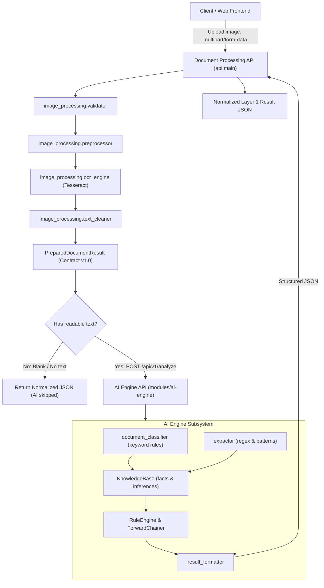

# IVP+AI — Architecture & Module Responsibilities

## Layer 1 System Architecture

## Module Guide

### 1. `image_processing/`
- `validator.py`: Enforces max file size, checks file extensions, verifies Pillow image decode integrity, and confirms format consistency.
- `preprocessor.py`: Applies EXIF rotation transpose, converts non-L modes to grayscale, upscales images with dimensions < 1000px using Lanczos resampling, and applies autocontrast and subtle contrast adjustment.
- `ocr_engine.py`: Tesseract adapter with automatic detection of standard Windows and environment paths. Returns structured `ProcessingError` instances.
- `text_cleaner.py`: Normalizes line endings (`\r\n` to `\n`), trims whitespace from lines, collapses excess newlines, and preserves alphanumeric content and punctuation.
- `models.py`: Defines `PreparedDocumentResult` and `ProcessingError`.
- `document_processor.py`: Pipeline coordinator producing `PreparedDocumentResult` conforming to `contracts/prepared_document.schema.json`.

### 2. `modules/ai-engine/`
- `api.py`: FastAPI application exposing `POST /api/v1/analyze`.
- `src/document_classifier.py`: Explainable keyword scoring classifying documents into `invoice`, `service_agreement`, or `general_document`.
- `src/extractor.py`: Extracts emails, phone numbers, dates, invoice numbers, invoice dates, and amounts due.
- `src/knowledge_base.py`: In-memory fact store separating source facts from inferred facts.
- `src/rule_engine.py`: IF-THEN rules with condition matching.
- `src/forward_chaining.py`: Forward-chaining inference engine iterating until a fixed point is reached.
- `src/result_formatter.py`: Normalizes results and reasoning steps.

### 3. `api/`
- `main.py`: Gateway FastAPI application. Exposes `/api/v1/documents/process`, `/api/v1/documents/prepare`, health, info, and static frontend hosting. Coordinates REST call to the AI Engine.

### 4. `frontend/`
- `index.html`, `script.js`, `style.css`: Minimal, functional web interface submitting live multipart requests to `/api/v1/documents/process` and rendering status, classification, extracted facts, raw text, metadata, and JSON output.

### 5. `contracts/`
- `prepared_document.schema.json`: JSON Schema draft 2020-12 defining the contract boundary between image preparation and AI reasoning.

## Known Limitations

- Only single PNG/JPEG images are supported.
- OCR quality depends on image quality and installed Tesseract language data.
- Orientation uses EXIF metadata; visual or skew-based rotation detection is not implemented.
- No OCR confidence score is generated.
- Preprocessing is deliberately modest.
- API multipart transport requires the `python-multipart` package.
